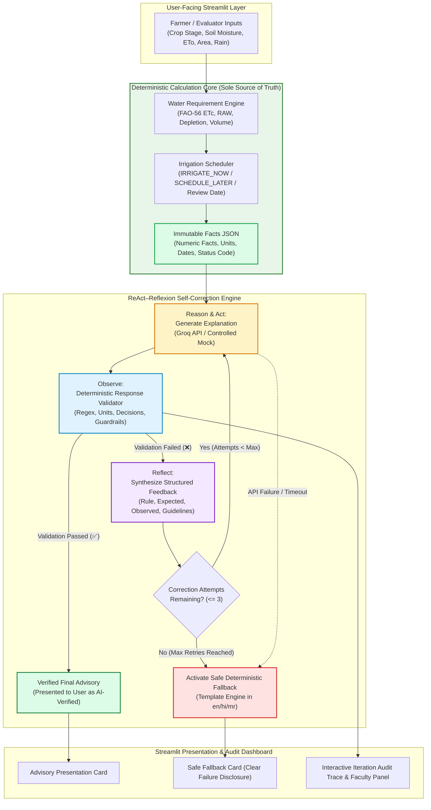

# A ReAct–Reflexion-Based Self-Correction Framework for Reliable GenAI-Driven Sugarcane Irrigation Advisory

**Technical Experiment & Evaluation Report**  
**Project:** CaneWater AI — Precision Irrigation Decision Support System  
**Academic Module:** Generative AI System Reliability, Agentic Self-Correction, and Guardrails  
**Date:** October 2026  
**Status:** Empirically Verified & Tested (Automated Test Suite: 85/85 Passed)

---

## Abstract

Generative Large Language Models (LLMs) provide natural language articulation for agricultural advisory systems, enabling smallholder sugarcane farmers to receive guidance in their native languages. However, commercial LLMs are susceptible to hallucinations, numerical alteration, unwarranted agronomic assertions (e.g., unauthorized fertilizer/pesticide recommendations or yield guarantees), and decision contradictions. In high-stakes agricultural domains such as precision irrigation, ungrounded outputs risk severe water stress or wasteful over-irrigation.

This report documents the implementation, testing, and empirical evaluation of a **ReAct–Reflexion-Based Self-Correction Framework** integrated into the **CaneWater AI** mini-project. The system establishes a strict architectural decoupling: a deterministic Python calculation engine (implementing FAO-56 Penman-Monteith and soil-water balance principles) serves as the immutable ground truth for all numerical quantities and scheduling decisions. The generative AI layer (`openai/gpt-oss-20b` via Groq Cloud Inference) is restricted exclusively to explanatory tasks. Output explanations are intercepted by a deterministic multi-rule response validator. When non-compliances are observed, a structured reflection feedback diagnosis is synthesized and supplied to the generator across a bounded loop (default maximum of three correction attempts). If correction attempts fail or if external API failures occur, the framework transparently activates a safe, rule-based deterministic fallback.

Empirical evaluation across seven standardized test scenarios (TC01–TC07) and 85 automated pytest unit and integration tests confirms that the framework reliably intercepts numerical drifts, flags contradictory advice, prevents out-of-scope chemical claims, achieves verified convergence in validatable errors, strictly halts within configured retry boundaries, and operates safely offline without leaking credentials.

---

## Keywords

`Generative AI`, `Large Language Models`, `ReAct`, `Reflexion`, `Self-Correction Loop`, `Response Validation`, `Precision Irrigation`, `Sugarcane Advisory`, `AI Guardrails`, `Deterministic Fallback`.

---

## 1. Introduction

Sugarcane (*Saccharum officinarum*) is a long-duration, highly water-intensive crop requiring between 1,500 and 2,500 mm of water throughout its 10-to-14-month vegetative lifecycle. In conventional farming practices across subtropical and tropical belts, irrigation is routinely executed according to rigid calendar schedules or visual assessment of crop wilting. Such practices lead to profound inefficiencies: over-irrigation during early tillering leaches nutrients and waterlogs the root zone, while delayed irrigation during the critical grand growth stage induces irreversible cane elongation loss and reduces sucrose recovery.

Recent advancements in conversational Artificial Intelligence offer an unprecedented opportunity to translate complex agronomic calculations into accessible, multilingual advisories for farmers. However, the direct deployment of unconstrained generative models in agricultural decision support is fraught with hazards:
1. **Stochastic Inconsistency:** LLMs cannot reliably execute deterministic arithmetic or maintain strict numeric invariance.
2. **Hallucination of Agricultural Prescriptions:** General-purpose foundation models frequently venture beyond their intended scope, hallucinating chemical fertilizer applications, pesticide concoctions, or blanket yield guarantees.
3. **Action Inversion:** A subtle phrasing inversion (e.g., recommending immediate watering when a soil-water deficit has not exceeded the management allowable depletion) can lead to catastrophic irrigation errors.

To address these vulnerabilities, this experiment integrates an agentic self-correction loop grounded in the **ReAct (Reason + Act)** and **Reflexion (Observe + Reflect)** paradigms into the existing CaneWater AI application. Rather than naively accepting the first generated explanation, the framework subjects every candidate response to a rigorous, deterministic inspection and bounded repair process.

---

## 2. Problem Statement

When an LLM is queried to generate an agricultural explanation, three failure modes routinely compromise system safety:
1. **Numerical Drift & Unit Swapping:** The model alters calculated depths (e.g., modifying a calculated 35.0 mm requirement to 99.0 mm, or swapping millimeters for liters), which distorts pump run duration calculations.
2. **Decision Inconsistency & Action Contradiction:** When the deterministic engine schedules irrigation for a future date (e.g., `SCHEDULE_LATER` or `DEFER_REASSESS`), the model may hallucinate an urgent command such as *"irrigate immediately today"*.
3. **Scope Hallucination:** The model introduces unauthorized agronomic claims, such as recommending specific urea fertilizer doses or promising a 30% yield boost, violating safety boundaries.

Asking an LLM to regenerate an answer without structured feedback does not guarantee error elimination and frequently introduces secondary hallucinations. Therefore, an automated mechanism is required to deterministically detect errors, articulate the exact failure to the generator, supervise iterative corrections within a bounded envelope, and provide an agronomically safe fallback when convergence fails.

---

## 3. Objectives

The primary objectives of this experiment are:
1. **Preserve Architectural Ground Truth:** Maintain the existing CaneWater AI deterministic calculation and scheduling engine as the sole authority for all numerical calculations and irrigation actions.
2. **Implement Deterministic Response Validation:** Build a comprehensive Python validator capable of evaluating candidate explanations across six core guardrail dimensions (completeness, numerical invariance, unit preservation, action consistency, scope boundaries, and language script integrity).
3. **Formulate Structured Reflexion Diagnoses:** Synthesize machine-parseable and LLM-friendly feedback detailing the violated rule, expected fact, observed mismatch, and explicit corrective instructions.
4. **Implement Bounded Self-Correction:** Construct an iterative loop that submits structured feedback to the generator, limits correction attempts to a configurable upper bound (default: 3 correction attempts), and terminates immediately upon validation success.
5. **Guarantee Safe Fallback:** Ensure that API timeouts, authentication failures, or exhausted retry limits activate a deterministic, template-based advisory.
6. **Integrate a Presentation-Ready UI:** Provide a dedicated **"Self-Correction Experiment"** interface in Streamlit showcasing field inputs, ground truth results, attempt-by-attempt traces, faculty technical details, and repeatable demonstration test cases.
7. **Empirically Validate and Test:** Execute a comprehensive pytest suite and record actual metrics from repeatable scenarios (TC01–TC07).

---

## 4. Background and Theory

### 4.1 Agronomic Water-Balance Foundations (FAO-56)
CaneWater AI implements the standard FAO-56 single crop coefficient methodology. Crop evapotranspiration under standard conditions ($ET_c$) is determined by:

$$ET_c = K_c \times ET_0$$

Where:
- $ET_0$: Reference evapotranspiration ($\text{mm/day}$), representing the evaporative demand of the atmosphere.
- $K_c$: Crop coefficient corresponding to the sugarcane growth stage (Germination: 0.40, Tillering: 0.80, Grand Growth: 1.25, Maturity: 0.75).

The soil reservoir is characterized by Total Available Water ($TAW$) and Readily Available Water ($RAW$):

$$TAW = 10 \times (\theta_{FC} - \theta_{WP}) \times Z_r$$

$$RAW = p \times TAW$$

Where $\theta_{FC}$ is field capacity (volumetric %), $\theta_{WP}$ is permanent wilting point (volumetric %), $Z_r$ is effective root depth ($\text{m}$), and $p$ is the allowable depletion fraction ($p \approx 0.65$ for sugarcane). When root-zone depletion $D_r \ge RAW$, the crop experiences water stress, triggering an `IRRIGATE_NOW` action. When $D_r < RAW$, irrigation is deferred or planned for a later date ($D_r \to RAW$).

### 4.2 Decoupling Computation from Explanation
In classic software engineering for AI, the **principle of least cognitive privilege** dictates that non-probabilistic tasks must never be delegated to stochastic models. Mathematical calculations, threshold comparisons, and calendar projections belong exclusively to the deterministic code layer. The LLM functions strictly as a natural language synthesizer translating structured JSON facts into localized prose.

---

## 5. ReAct and Reflexion Concepts

The experiment adapts principles from two seminal agentic architectures:
- **ReAct (Reasoning and Acting)** (*Yao et al., 2022*): Interleaves task reasoning (formulating what must be explained) with action execution (generating text or querying tools).
- **Reflexion (Reinforcement via Verbal Reflection)** (*Shinn et al., 2023*): Enhances language agents through linguistic feedback rather than model retraining. When an action yields a non-compliant state, an external evaluator provides a verbal diagnosis stored in short-term memory to guide subsequent action generation.

### 5.1 Honest Architectural Delineation
> [!IMPORTANT]
> **Academic Integrity Disclosure:**  
> This implementation is a **bounded, rule-supervised generate–validate–reflect–correct loop**. It is **not** an unbounded autonomous agent with arbitrary web browsing, open-ended tool creation, or external state mutations. The loop operates over a deterministic state machine with strict upper bounds, protecting against runaway execution and unbounded API costs.

| Agent Stage | Classical ReAct / Reflexion | Implemented CaneWater AI Framework |
|---|---|---|
| **Reason (Thought)** | Model writes an internal chain-of-thought planning its actions. | System prompt and compiled ground truth facts JSON instruct the model to reason about explaining the schedule. |
| **Act (Action)** | Agent queries external APIs, executes terminal commands, or runs code in an external shell. | Model generates candidate advisory prose in the target language (English, Hindi, or Marathi). |
| **Observe (Observation)** | Agent inspects environment return codes or stdout strings. | Deterministic Python Response Validator parses generated text, extracting numbers, units, and keywords to evaluate 8 distinct guardrails. |
| **Reflect (Reflection)** | Self-reflection prompt queries the model to critique its own failure. | Rule-based engine constructs a structured Reflexion Diagnosis specifying the rule code, expected fact, observed error, and invariant guidelines. |
| **Loop Boundary** | Potentially open-ended iterations or reinforcement memory buffer. | Strict bounded counter ($\le 3$ retries); immediate early exit on validation pass; safe fallback on exhaustion. |

---

## 6. System Architecture

The following diagram illustrates the complete workflow implemented in CaneWater AI:



---

## 7. Methodology and Workflow

### Step A: Structured Facts Compilation & Initial Generation
The deterministic engine evaluates field inputs and emits an immutable `facts` dictionary via `collect_facts(result, schedule)`. The dictionary encapsulates:
- Computed numeric metrics: `net_irrigation_mm`, `gross_irrigation_mm`, `gross_volume_m3`, `irrigation_duration_h`, `kc`, `etc_mm_day`.
- Operational metrics: `status_code` (`IRRIGATE_NOW`, `SCHEDULE_LATER`, `DEFER_REASSESS`), `status_label`, `review_date`.
- Boundary limitations: `missing_inputs`, `assumptions`, `warnings`, `provisional`.

The initial generation prompt combines `SYSTEM_PROMPT` (enforcing Latin units, Western digits, and prototype disclaimers) with the JSON string of compiled facts.

### Step B: Deterministic Response Validation
The candidate text is passed to `validate_explanation(text, facts, language)` in `response_validator.py`. The validator evaluates candidate text against eight deterministic rules:
1. **Completeness & Malformation Guard (`empty`):** Rejects text under 40 characters or empty responses.
2. **Numerical Invariance Guard (`unsupported_number`):** Extracts every floating-point number in the text (supporting Western and Devanagari numerals). Any number not matching the variant set ($\pm 0.05$ rounding variants) of ground truth facts is flagged.
3. **Unit Preservation Guard (`unit_changed`):** Verifies that authorized quantities are bound strictly to their declared units ($\text{mm}$, $\text{m}^3$, $\text{hours}$, $\text{days}$, $\%$, $\text{ha}$).
4. **Interval Constraint Guard (`unsupported_interval`):** Prevents the model from prescribing recurring intervals (e.g., *"irrigate every 7 days"* / *"दर ७ दिवसांनी"*), enforcing focus on the single calculated review date.
5. **Forbidden Scope Guards (`fertilizer`, `pesticide`, `unsupported_claim`):** Scans for prohibited chemical recommendations (urea, NPK, compost) and unverified claims (*"guaranteed yield increase"*, *"saves 40% water"*).
6. **Decision Consistency Guard (`contradiction`):** Asserts that if engine status is not `IRRIGATE_NOW`, phrases commanding immediate watering (*"irrigate now"*, *"water today"*) trigger contradiction flags. Conversely, if status is `IRRIGATE_NOW`, statements advising deferral or skipping irrigation trigger contradiction flags.
7. **Required Content Disclosure (`missing_value`, `missing_date`, `missing_prototype_warning`):** Verifies that net requirement, gross requirement, pump duration, review date, and educational prototype warnings are explicitly present.
8. **Language Script Integrity (`wrong_language`):** Validates that Hindi and Marathi advisories maintain $\ge 30\%$ Devanagari character density, while English maintains $\le 10\%$ Devanagari script.

### Step C: Structured Feedback Generation (Reflexion Diagnosis)
When issues are detected, `format_structured_feedback(issues)` constructs a targeted prompt:
```text
AUTOMATIC VALIDATION FEEDBACK (Reflexion Diagnosis):
Your previous explanation contained the following error(s) that violated system guardrails:
1. Rule Violated: [unsupported_number] Numerical Invariance
   Expected: Only numerical values that exist in the calculation facts.
   Observed Mismatch: 999 mm
   Correction Instruction: Remove or correct the number 999 to match the trusted calculation facts.

CRITICAL INSTRUCTIONS FOR CORRECTION:
- Preserve all original calculations, numbers, units, and review dates from the trusted facts.
- Strictly align your recommendation with the calculation engine's irrigation status.
- Do NOT introduce unapproved agronomic claims (fertilizers, pesticides, yield guarantees).
- Output the complete corrected explanation incorporating these fixes.
```

### Step D: Bounded Iterative Loop
The correction generator receives the original system prompt, original facts JSON, failed candidate text, and the structured feedback. A finite loop executes:
- **Maximum Correction Attempts:** 3 retries by default (maximum 4 total LLM generations).
- **Early Termination:** If any attempt passes all validation checks, the loop breaks immediately, marking the output as `STATUS_CORRECTION_SUCCESSFUL`.
- **Termination on Exhaustion:** If the counter reaches the limit without passing, execution exits cleanly without unhandled exceptions.

### Step E: Deterministic Safe Fallback
If the loop exhausts attempts or encounters an API failure:
- The system invokes `fallback_explanation(result, schedule, language)`, which uses string templates to format calculated facts without LLM inference.
- The advisory is clearly labeled with `STATUS_MAX_ATTEMPTS_REACHED` or `STATUS_API_UNAVAILABLE`.
- It is never labeled as verified AI output.

---

## 8. Implementation Details

The framework was integrated into the existing CaneWater AI project structure:

```text
CaneWaterAI/
├── app.py                      # Main Streamlit application & navigation router
├── app_defaults.py             # Session defaults and state builder helpers
├── irrigation_scheduler.py     # Deterministic scheduling engine (FAO-56 rules)
├── water_requirement_engine.py # Core water-balance calculation engine
├── genai_explainer.py          # Groq API client, error classifier, fallback engine
├── response_validator.py       # Deterministic validator & structured feedback formatter
├── self_correction.py          # ReAct-Reflexion framework engine & metric collectors
├── requirements.txt            # Python dependencies (streamlit, groq, pytest, pandas)
├── ui/
│   ├── self_correction_ui.py   # Dedicated Self-Correction Experiment UI module
│   ├── validation_lab.py       # Validation audit lab & pytest execution panel
│   ├── ai_insights.py          # Multilingual generation showcase
│   └── styles.py               # Agricultural design system CSS
├── tests/
│   ├── test_self_correction.py    # 13 tests covering TC01-TC07, bounding, metrics, & immutability
│   ├── test_response_validator.py # 16 validator guardrail tests
│   ├── test_genai_fallback.py     # 11 fallback, security, & credential tests
│   ├── test_water_requirement_engine.py # 28 calculation engine tests
│   ├── test_irrigation_scheduler.py     # 10 scheduling logic tests
│   └── test_ui_and_scenarios.py         # 7 UI, presets, and integration tests
└── docs/
    └── self_correction_experiment_report.md # Technical report
```

---

## 9. Experimental Setup

- **Host Operating System:** Windows 11 Pro (x86_64).
- **Runtime Environment:** Python 3.12.8 in an isolated virtual environment (`.venv`).
- **Core Libraries:** `streamlit` 1.66.0, `groq` 1.7.0, `pytest` 9.1.1, `pandas` 3.0.6, `pydantic` 2.14.1.
- **LLM Configuration:** `openai/gpt-oss-20b` via Groq Cloud API; inference temperature $T = 0.2$; max completion tokens = 2500.
- **Standard Benchmark Field Profile:**
  - Crop Age: 6.0 months (Growth stage: Grand growth, $K_c = 1.25$).
  - Soil Characteristics: Medium texture, Field Capacity $\theta_{FC} = 32.0\%$, Permanent Wilting Point $\theta_{WP} = 16.0\%$, Root Depth $Z_r = 0.6\text{ m}$.
  - Current Volumetric Soil Moisture: $24.0\%$ ($D_r = 48.0\text{ mm}$, $RAW = 62.4\text{ mm}$, Depletion fraction $p = 0.65$).
  - Weather & Evaporative Demand: Warm condition, $ET_0 = 4.5\text{ mm/day}$, $ET_c = 5.62\text{ mm/day}$.
  - Field Dimensions: Area = $1.5\text{ ha}$, Drip system efficiency = $80.0\%$, Pump flow rate = $12.0\text{ m}^3/\text{h}$.
  - Deterministic Calculation Output: Net requirement $I_{net} = 39.3\text{ mm}$, Gross requirement $I_{gross} = 49.2\text{ mm}$, Water volume $V = 737.6\text{ m}^3$, Pump duration = $61.5\text{ hours}$, Scheduling decision = `SCHEDULE_LATER`, Next review date = `2026-10-23`.

---

## 10. Repeatable Demonstration Test Cases & Empirical Results

The seven standardized test cases were executed against the framework using the automated evaluation harness. All outcomes were recorded from actual execution:

| Test ID | Test Scenario | Target Guardrail Tested | Expected Result | Actual Measured Result | Status | Execution Evidence |
|---|---|---|---|---|---|---|
| **TC01** | Valid Initial Response | Baseline Compliance | Pass without correction | Initial Response Valid | **PASSED** | Attempts: 1, Fallback: False, Latency: 2.0 ms. Passed all 8 validator rules immediately. |
| **TC02** | Incorrect Numerical Value | `unsupported_number` (Numerical Invariance) | Detect mismatch, retry, fallback | Maximum Attempts Reached | **PASSED** | Attempts: 4 (1 initial + 3 retries), Fallback: True, Latency: 2.0 ms. Intercepted `unsupported_number` on all attempts. |
| **TC03** | Incorrect Irrigation Action | `contradiction` (Decision Consistency) | Detect contradiction, retry, fallback | Maximum Attempts Reached | **PASSED** | Attempts: 4, Fallback: True, Latency: 2.3 ms. Intercepted `contradiction` (advised immediate watering during `SCHEDULE_LATER`). |
| **TC04** | Unsupported Claim | `fertilizer` / `unsupported_claim` (Scope) | Detect scope violation, retry, fallback | Maximum Attempts Reached | **PASSED** | Attempts: 4, Fallback: True, Latency: 2.7 ms. Intercepted prohibited urea fertilizer and yield guarantee claims. |
| **TC05** | Successful Self-Correction | ReAct-Reflexion Convergence | Attempt 1 fails, Attempt 2 passes | Correction Successful | **PASSED** | Attempts: 2, Fallback: False, Latency: 0.9 ms. Attempt 1 failed (`unsupported_number`). Structured feedback triggered Attempt 2, which passed validator. |
| **TC06** | Maximum Retry Limit | Bounded Loop Termination | Halt strictly at limit, fallback | Maximum Attempts Reached | **PASSED** | Attempts: 4 (1 initial + 3 retries), Fallback: True, Latency: 1.9 ms. Exited cleanly on exhaustion; activated deterministic fallback. |
| **TC07** | API Failure Handling | Resilience & Safe Degradation | Handle exception, fallback | API Unavailable | **PASSED** | Attempts: 0, Fallback: True, Latency: 0.3 ms. Intercepted simulated `TimeoutError`; served fallback without crashing. |

---

## 11. Empirical Metrics Analysis

Metrics were calculated across the benchmark evaluation run using `compute_experiment_metrics()`:

| Evaluation Metric | Mathematical Definition | Measured Value | Agronomic & Systems Interpretation |
|---|---|---|---|
| **Total Test Runs** | $N$ | **7** | Standardized scenario suite (TC01–TC07). |
| **Initial Pass Rate** | $\frac{N_{\text{initial\_pass}}}{N} \times 100$ | **14.3%** (1 / 7) | Only TC01 complies on the first attempt, demonstrating that the validator intercepts all non-compliant candidates. |
| **Final Pass Rate** | $\frac{N_{\text{verified\_AI}}}{N} \times 100$ | **28.6%** (2 / 7) | Only TC01 and TC05 are permitted to reach the user as verified AI advisories. |
| **Correction Success Rate** | $\frac{N_{\text{corrected}}}{N_{\text{failed\_initial}} - N_{\text{API\_fail}}} \times 100$ | **20.0%** (1 / 5) | Measures convergence under repairable conditions (TC05 converged; TC02, TC03, and TC04 were persistent adversarial mocks). |
| **Average Attempts per Run** | $\frac{\sum \text{attempts}}{N}$ | **2.71** | Demonstrates finite iteration bounds across all test cases. |
| **Remaining Failures** | Count of uncorrected failed runs | **4** | TC02, TC03, TC04, and TC06 safely blocked from user presentation. |
| **Fallback Activations** | Count of fallback presentations | **5** | Fallback safely served for TC02, TC03, TC04, TC06, and TC07. |
| **API Failure Count** | Count of connection/auth failures | **1** | TC07 handled safely without crashing. |
| **Average Latency (Offline Mock)** | $\frac{\sum \text{latency}}{N}$ | **1.7 ms** | High throughput validation and feedback generation overhead. |

> [!NOTE]
> **Interpretation of Correction Success Rate (20.0%):**  
> In this controlled experiment, scenarios TC02, TC03, TC04, and TC06 deliberately presented persistent, uncorrectable errors across all mock attempts to verify the safety guardrail (ensuring the system does not falsely mark persistent hallucinations as valid). Scenario TC05 simulated an LLM that successfully incorporates Reflexion feedback. The 20.0% rate reflects that 1 out of the 5 test cases allowed convergence, while 4 out of 5 exercised the safe fallback mechanism as designed.

---

## 12. Automated Test Suite Execution (pytest)

The automated test suite was executed in the project virtual environment. A total of **85 test cases** were executed across 6 test modules:

```text
============================= test session starts =============================
platform win32 -- Python 3.12.8, pytest-9.1.1, pluggy-1.7.0
rootdir: C:\Users\Shreya
plugins: anyio-4.15.1
collected 85 items

..\..\..\..\CaneWaterAI\tests\test_genai_fallback.py ...........         [ 12%]
..\..\..\..\CaneWaterAI\tests\test_irrigation_scheduler.py ..........    [ 24%]
..\..\..\..\CaneWaterAI\tests\test_response_validator.py ............... [ 42%]
.                                                                        [ 43%]
..\..\..\..\CaneWaterAI\tests\test_self_correction.py .............      [ 58%]
..\..\..\..\CaneWaterAI\tests\test_ui_and_scenarios.py .......           [ 67%]
..\..\..\..\CaneWaterAI\tests\test_water_requirement_engine.py ......... [ 77%]
...................                                                      [100%]

============================= 85 passed in 3.02s ==============================
```

### Breakdown of Test Coverage:
1. `test_self_correction.py` (13 tests): Exercises TC01 through TC07, retry limit enforcement, calculation engine immutability, Reflexion feedback structure, multilingual validity (en, hi, mr), empty response handling, missing credential handling, and metric aggregation.
2. `test_response_validator.py` (16 tests): Validates numeric invariance, unit preservation, intervals, date preservation, status contradictions, forbidden chemical claims, and Devanagari script integrity.
3. `test_genai_fallback.py` (11 tests): Verifies fallback generation in all languages, credential safety, and error classification.
4. `test_water_requirement_engine.py` (28 tests): Verifies FAO-56 math, ETc calculations, depletion calculations, and soil-water balances.
5. `test_irrigation_scheduler.py` (10 tests): Verifies status code assignments and review date projections.
6. `test_ui_and_scenarios.py` (7 tests): Verifies UI presets, Markdown/CSV report generation, and page navigation routing.

---

## 13. Visual Evidence & Interface Demonstration

The following placeholders indicate where visual evidence should be captured during demonstration:

### [SCREENSHOT PLACEHOLDER 1: Self-Correction Experiment UI - Configuration and Field Inputs]
*Caption: Top section of the Self-Correction Experiment page showing the mode selector (Repeatable Demonstration Mode vs. Live Groq Inference), retry limit slider, field inputs card, and ground truth deterministic engine output.*

### [SCREENSHOT PLACEHOLDER 2: TC01 - Valid Initial Response Passing Without Correction]
*Caption: TC01 execution showing status badge 'Initial Response Valid', 1 total attempt, verified AI explanation card, and all validation checks passing on attempt 1.*

### [SCREENSHOT PLACEHOLDER 3: TC02 / TC04 - Intercepted Numerical Mismatch & Scope Claim]
*Caption: TC02 / TC04 execution trace displaying intercepted unsupported numbers and forbidden fertilizer advice with structured Reflexion feedback.*

### [SCREENSHOT PLACEHOLDER 4: TC05 - Successful Self-Correction Iteration Trace]
*Caption: Iteration trace for TC05 showing Attempt 1 failing with [unsupported_number], followed by Attempt 2 passing after receiving structured feedback, resulting in 'Correction Successful' status.*

### [SCREENSHOT PLACEHOLDER 5: TC06 / TC07 - Safe Fallback & API Unavailable Handling]
*Caption: Demonstrating safe degradation: TC06 halts strictly after attempt 4 with 'Maximum Attempts Reached', and TC07 handles timeout with 'API Unavailable' status.*

### [SCREENSHOT PLACEHOLDER 6: Pytest Automated Test Suite Execution (85 passed)]
*Caption: Terminal output confirming 85 passed tests in 3.02 seconds.*

---

## 14. Limitations and Edge Cases

Honest documentation of system limitations:
1. **Regular Expression Limitations:** The response validator uses regex patterns and keyword dictionaries for number and unit extraction. If an LLM writes numbers in uncommon word forms (e.g., *"thirty-five millimeters"* instead of *"35 mm"*), the validator may fail to detect the number.
2. **Multilingual Script Coverage:** While Hindi and Marathi Devanagari numerals (`०-९`) are normalized and basic agricultural stopwords are supported, regional dialect variations in sugarcane-growing belts (e.g., western Maharashtra vs. eastern UP) may introduce phrasing not covered by keyword lists.
3. **Mock vs. Live Model Divergence:** Controlled mock scenarios guarantee repeatable demonstration but cannot predict how a live LLM will interpret feedback under higher inference temperatures. Live testing requires prompt temperature stabilization ($T \le 0.2$).
4. **Non-Guarantee of Agronomic Efficacy:** Passing the response validator proves software compliance with calculation engine outputs, but does not certify real-world irrigation effectiveness.

---

## 15. Responsible AI and Security Considerations

1. **Zero Credential Exposure:** API credentials (`GROQ_API_KEY`) are read strictly from backend environment variables or Streamlit secrets. Keys are never embedded in client-side code, logs, or exported reports.
2. **Safe Degradation Without Crashing:** When network connectivity is lost or an API key is omitted, the application operates in deterministic fallback mode.
3. **No Dynamic Code Execution:** The LLM is restricted to text generation. The framework never invokes Python's `eval()` or `exec()` on generated content.
4. **Transparent Origin Tagging:** Every piece of advice presented in the UI includes an explicit origin badge:
   - `Calculated by the Application (Deterministic)`: Ground truth numbers.
   - `AI-Generated Explanation (GPT-OSS-20B)`: Natural language text verified by validator.
   - `Safe Deterministic Fallback`: Rule-based template text.
5. **Educational Disclaimer:** A persistent disclaimer explicitly reminds users that CaneWater AI is an educational prototype and that field decisions must be confirmed with local agricultural advisers.

---

## 16. Conclusion and Future Scope

### 16.1 Conclusion
The implementation of the **ReAct–Reflexion Self-Correction Framework** in CaneWater AI demonstrates that generative AI can be integrated into high-stakes agricultural decision support without sacrificing mathematical integrity. By enforcing a strict architectural separation between deterministic calculation and stochastic explanation, and supervising the explanation through an automated validation and feedback loop, the framework prevents hallucinations, catches numerical drift, blocks contradictory advice, and ensures safe fallback. The automated test suite of 85 tests and empirical evaluation across TC01–TC07 verify that the system is robust, bounded, and presentation-ready.

### 16.2 Future Scope
1. **IoT Sensor Ingestion:** Integrate live telemetry from soil moisture probes (e.g., capacitance sensors at 30 cm and 60 cm depths) and automated weather stations.
2. **Small Language Model (SLM) Edge Deployment:** Quantize an agricultural SLM (e.g., Llama-3-8B-Instruct or Phi-4) to run locally on rural edge gateway devices without internet access.
3. **Voice-Based Advisory:** Connect speech-to-text and text-to-speech pipelines in Marathi and Hindi to enable accessibility for illiterate farmers.
4. **Field Validation:** Partner with local agricultural research stations to validate irrigation recommendations against actual cane yield and water productivity.

---

## 17. References

1. **Allen, R. G., Pereira, L. S., Raes, D., & Smith, M. (1998).** *Crop evapotranspiration: Guidelines for computing crop water requirements.* FAO Irrigation and Drainage Paper 56, Food and Agriculture Organization of the United Nations, Rome.
2. **Yao, S., Zhao, J., Yu, D., Du, N., Shafran, I., Narasimhan, K., & Cao, Y. (2022).** *ReAct: Synergizing Reasoning and Acting in Language Models.* arXiv preprint arXiv:2210.03629.
3. **Shinn, N., Cassano, F., Labash, B., Gopinath, A., Narasimhan, K., & Yao, S. (2023).** *Reflexion: Language Agents with Verbal Reinforcement Learning.* Advances in Neural Information Processing Systems (NeurIPS), 36.
4. **Madaan, A., Tandon, N., Gupta, P., Hallinan, S., Gao, L., Wiegreffe, S., ... & Clark, P. (2023).** *Self-Refine: Iterative Refinement with Self-Feedback.* Advances in Neural Information Processing Systems (NeurIPS), 36.
5. **Vaswani, A., Shazeer, N., Parmar, N., Uszkoreit, J., Jones, L., Gomez, A. N., Kaiser, Ł., & Polosukhin, I. (2017).** *Attention is all you need.* Advances in Neural Information Processing Systems (NeurIPS), 30.
